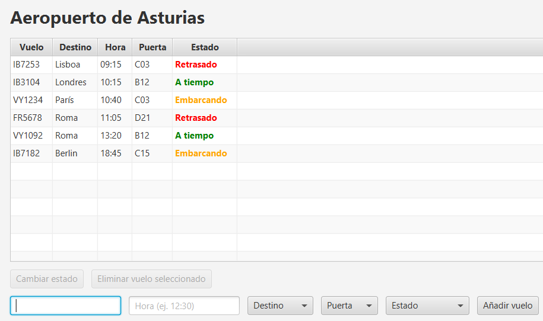
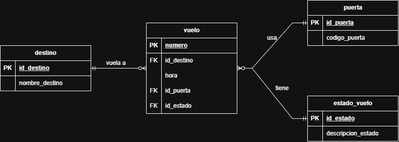

# Panel de Vuelos ✈️

Panel de salidas de aeropuerto hecho con Java, JavaFX y SQLite.

## Qué hace
- Muestra una tabla de salidas leída desde una base de datos SQLite.
- El estado de cada vuelo se ve con color (verde, naranja, rojo, gris).
- Permite añadir vuelos con un formulario, con validación del formato de la hora.
- Permite eliminar vuelos (con confirmación) y cambiar su estado.

## Base de datos
Diseñada con tablas separadas para destinos, puertas y estados, relacionadas con claves foráneas.

## Tecnologías
- Java 23
- JavaFX 21
- SQLite (JDBC)

## Cómo ejecutarlo
1. Descarga JavaFX 21 (gluonhq.com/products/javafx) y añade sus .jar al proyecto.
2. Añade sqlite-jdbc y slf4j-api al proyecto.
3. Ejecuta `Main` con estos argumentos de la VM:
   `--module-path "RUTA_A_JAVAFX/lib" --add-modules javafx.controls`

## Próximos pasos
- Migrar a Maven
- Refresco automático del panel
- Compañías y códigos IATA
- Datos reales mediante una API
- Versión web